# Previsão de risco na alfabetização dos municípios brasileiros

Modelo que antecipa **quais municípios não vão atingir a meta de alfabetização do ano seguinte**, explica o porquê de cada alerta e gera a lista de prioridade para 2025. Com os microdados do INEP, desce até **a escola e o aluno**: mede onde está a desigualdade e até onde dá para prever se uma criança será alfabetizada.

Projeto de portfólio construído a partir do Tech Challenge da Fase 3 da pós em IA (FIAP). Continua a [pipeline de dados da Fase 2](https://github.com/leonardoaz98/aws-tech-challenge2-fiap) (arquitetura Medallion na AWS), que entrega a camada Gold usada aqui.

**Resultados principais**
- **Município:** regressão logística com AUC de 0,80 no teste, calibrada para detectar 81% dos municípios que falham. Ranking de 2025 com 5.352 municípios, 617 em risco crítico.
- **Aluno:** AUC de 0,663 por criança, em municípios nunca vistos no treino: ~68% do caminho até o máximo possível com dados de escola. 77% da diferença entre as crianças está dentro da mesma escola.
- **Escolas:** ~770 escolas críticas reais (abaixo de 40%) escondidas em municípios que bateram a meta de 2024.
- **Validação real:** o resultado de 2025 saiu e a previsão foi conferida. AUC de 0,68 num ano que o modelo nunca viu, abaixo dos 0,80 do teste e abaixo de uma regra simples (0,745). O país melhorou 9,5 p.p. em um ano e o modelo, treinado num ano ruim, superestimou o risco. Detalhes na seção 6.6.

| | |
|---|---|
| Vídeo executivo (5 min) | _link após a gravação_ |
| Documentação técnica | [`reports/documentacao_tecnica.md`](reports/documentacao_tecnica.md) |
| Notebooks | [01 · Análise exploratória](notebooks/01_analise_exploratoria.ipynb) · [02 · Modelagem e resultados](notebooks/02_modelagem_e_resultados.ipynb) · [03 · Escolas e modelo por aluno](notebooks/03_escolas_e_modelo_aluno.ipynb) |
| Ranking 2025 | [`reports/ranking_2025.csv`](reports/ranking_2025.csv) |
| Ranking 2025 x resultado real | [`reports/validacao_2025.json`](reports/validacao_2025.json) |
| Municípios com escolas críticas | [`reports/municipios_com_escolas_criticas.csv`](reports/municipios_com_escolas_criticas.csv) |

---

## 1. Contexto do problema

O Compromisso Nacional Criança Alfabetizada quer que toda criança esteja alfabetizada ao fim do 2º ano do ensino fundamental. O INEP mede isso com o **Indicador Criança Alfabetizada**: o percentual de alunos que atingem 743 pontos na escala de leitura e escrita. Cada município tem uma **meta anual própria**, calculada a partir do seu ponto de partida, rumo a 80% em 2030.

Hoje o acompanhamento é retrospectivo. O gestor descobre que o município falhou quando o resultado sai, e aí a turma já passou do 2º ano. A pergunta deste projeto é se dá para **avisar antes**.

## 2. Objetivo analítico

> Quais municípios têm maior risco de não atingir a meta do próximo ano, e o que explica esse risco? E, descendo ao nível da criança: dá para prever se um aluno será alfabetizado, e onde está a desigualdade?

O projeto tem **dois níveis**, cada um respondendo uma parte do enunciado:

**Nível 1 · Município** (seções 4 a 7)

| Elemento | Definição |
|---|---|
| Unidade | Município, rede municipal de ensino |
| Alvo | `risco = 1` se o município **não** atingiu a meta |
| Treino | features de **2023** → resultado de **2024** |
| Previsão | features de **2024** → meta de **2025**, conferida com o resultado real de 2025 (6.6) |
| Métrica principal | AUC (qualidade da fila de prioridade) + recall da classe de risco |

**Nível 2 · Aluno** (seções 3.5, 4.4, 5.3, 6.5, 7.7, 8.5 e 8.6)

| Elemento | Definição |
|---|---|
| Unidade | Aluno do 2º ano avaliado em 2024, com o peso amostral do INEP |
| Alvo | `alfabetizado = 1` se a proficiência é ≥ 743 |
| Variáveis | Município em 2023 + escola em 2024 (rede e tamanho), todas conhecidas antes da prova |
| Validação | 25% dos municípios guardados para teste; busca em grade com `GroupKFold` por município no treino |
| Métrica | AUC por aluno no teste, comparada com dois tetos teóricos |

**Por que os dois níveis.** A política de alfabetização é desenhada e financiada por rede de ensino, então **o município é a unidade de decisão** e é onde a antecipação acontece (nível 1). O enunciado pede prever a criança, e os microdados do INEP permitem isso (nível 2), com uma ressalva importante: eles não trazem nada da criança antes da prova, só a escola e o município onde ela estuda. O nível 2 mostra até onde esse contexto leva.

**Por que a classe positiva é "não atingiu".** É o evento que a política quer pegar. Assim recall, precisão e limiar falam direto de "municípios que vão falhar", sem inversão.

## 3. Descrição da base utilizada

### 3.1 Origem

| Fonte | Conteúdo | Arquivo |
|---|---|---|
| Gold da Fase 2 (INEP via Base dos Dados) | Taxa de alfabetização, média em português, participação, metas 2024-2030 | `data/gold/` |
| IBGE Localidades | Nome, micro e mesorregião | `data/raw/ibge/ibge_localidades.csv` |
| IBGE SIDRA 6579 | População estimada (2021) | `data/raw/ibge/ibge_populacao.csv` |
| IBGE SIDRA 5938 | PIB municipal (2021) | `data/raw/ibge/ibge_pib.csv` |
| INEP · microdados da Avaliação da Alfabetização (2023 e 2024) | Um registro por aluno: escola, rede, presença, proficiência, peso | `data/raw/inep/alunos_por_escola.csv` (agregado por escola) |
| INEP · resultado de 2025 por município (`TS_MUNICIPIO`, dos microdados de 2025) | Taxa de 2025 com casas decimais e média em português. Mesmo arquivo que a Base dos Dados publica para 2023 e 2024 | `data/raw/inep/TS_MUNICIPIO_2025.csv` |
| INEP · planilhas de divulgação 2025 (municípios e UFs) | Indicador oficial, participação de 2025, resultado e metas do Brasil e das UFs | `data/raw/inep/resultados_e_metas_*_2025.xlsx` |

### 3.2 Gold: reconstruída localmente, com contrato

Na Fase 2 a Gold é um star schema no S3, consultado via Athena. Para o projeto rodar em qualquer máquina, [`src/preprocessing/gold.py`](src/preprocessing/gold.py) reconstrói a Gold a partir dos CSVs públicos do INEP e grava um snapshot em `data/gold/`:

```
fato_alfabetizacao   id_municipio + ano   43.008 linhas (2023-2025 medidos, 2026-2030 só meta)
fato_meta_uf         sigla_uf + ano          224 linhas (27 UFs + Brasil, resultado e meta 2023-2030)
dim_municipio        5.500   ·   dim_uf  25   ·   dim_tempo  8   ·   dim_nivel  6
```

As 43.008 linhas batem com o documentado na Fase 2. O resultado de 2025, publicado depois da Fase 2, preenche as linhas de 2025 que antes só tinham meta. O esquema é o que **as views do Athena e o dashboard da Fase 2 leem** (`taxa_realizada`, `meta`, `gap_meta`, `meta_atingida`), e não os nomes que o `build_gold.py` da Fase 2 grava (`taxa_alfabetizacao`); essa diferença quebrava as views na Fase 2.

Para não repetir: o esquema de cada tabela está escrito uma vez em [`contrato_gold.py`](src/preprocessing/contrato_gold.py) e é conferido **ao gravar, ao ler e contra a documentação técnica**. Coluna faltando, coluna a mais, tipo errado ou chave duplicada param o pipeline. A leitura direta do S3 foi retirada: sem acesso ao bucket não havia como testá-la.

### 3.3 Variáveis

| Variável | Tipo | Origem |
|---|---|---|
| `taxa_atual` | numérica | taxa de alfabetização do ano de entrada |
| `media_portugues` | numérica | média de proficiência em português |
| `participacao` | numérica | % de alunos que fizeram a avaliação |
| `esforco_exigido` | numérica | meta do ano-alvo − taxa atual |
| `log_populacao` | numérica | log da população (assimetria forte) |
| `log_pib_per_capita` | numérica | log do PIB por habitante |
| `sigla_uf`, `regiao`, `porte_municipio` | categóricas | território e porte |

Fora do modelo, com motivo:

| Variável | Motivo |
|---|---|
| `meta_alvo` | É `taxa_atual + esforco_exigido`. As três juntas são colineares e os coeficientes perdem sentido |
| `nivel_alfabetizacao` | Faixa (0-5) da própria taxa |
| `_taxa_alvo` | É de onde o alvo sai. Fica só para auditoria |

### 3.4 Cobertura

| | Treino (2023→2024) | Previsão (2024→2025) |
|---|---|---|
| Municípios | 5.232 | 5.352 |
| UFs | 24 | 25 |
| Nulos nas features | 0 | 0 |
| Não atingiram | 46,7% | — |

Fora: **DF** (não tem rede municipal) e **RR** (sem rede municipal na avaliação). O **AC** não tem dado de 2024 no treino, mas aparece em 2025; seus 22 municípios são avaliados sem o efeito de UF. 216 municípios de 2023 ficaram fora do treino: 52 sem resultado em 2024 e 164 sem meta de 2024. Cada descarte do projeto, com contagem e motivo, está em [`reports/funil.json`](reports/funil.json).

### 3.5 Microdados por aluno

O INEP publica um arquivo por ano com **uma linha por aluno do 2º ano** (`TS_ALUNO.csv`): 1,75 milhão em 2023 e 2,12 milhões em 2024. É a mesma fonte da tabela `alunos` da Base dos Dados. [`microdados_inep.py`](src/preprocessing/microdados_inep.py) lê os zips direto do site do INEP e agrega por escola × rede × ano (79 mil linhas, 4,8 MB, versionado). Os zips ficam fora do git.

Por que agregar: os microdados não trazem nada da criança antes da prova (sexo, cor, renda, idade). Todas as variáveis são da escola ou do município, então treinar com uma linha por aluno ou com as contagens de alfabetizados e não alfabetizados por escola produz **exatamente o mesmo modelo**.

| Conferência | Resultado |
|---|---|
| Taxa por município (rede municipal, ponderada) × indicador oficial | erro médio **0,03 p.p.**, 97% dos municípios abaixo de 0,1 |
| `alfabetizado` do INEP × proficiência ≥ 743 | 100% de concordância |
| Escolas de 2024 com o mesmo código em 2023 | **2%**: o INEP mascara o código a cada edição |

A primeira linha valida a extração inteira: somando os alunos com o peso do INEP, o indicador oficial é reproduzido. A última define o desenho do modelo por aluno: **não existe histórico de escola**, porque o código muda de um ano para o outro.

## 4. Etapas de modelagem

```
CSVs e planilhas INEP ─► gold.py ─► data/gold/ (fato_alfabetizacao, fato_meta_uf, dimensões)
                            │        conferida por contrato_gold.py ao gravar e ao ler
IBGE ───────────────────────┴─► base_analitica.py ─► base_treino / base_previsao  (+ reports/funil.json)
                                                       │   (o resultado de 2025 fica fora da previsão)
                                                       ├─► eda.py ────────────► images/eda_*, reports/eda_resumo.json
                                                       ├─► treinar.py ────────► models/modelo.joblib, reports/resultado_modelo.json
                                                       ├─► interpretar.py ────► images/interp_*, reports/interpretabilidade.json
                                                       ├─► aplicacao.py ──────► reports/ranking_2025.csv, perfis, UF
                                                       ├─► drift.py ──────────► reports/drift.json
                                                       └─► validacao_2025.py ─► reports/validacao_2025.json (ranking x resultado real)

Microdados INEP ─► microdados_inep.py ─► alunos_por_escola.csv ─► escolas.py ─► data/gold/fato_escola.parquet
                                                                                    │
                                                                                    ├─► desigualdade.py ─► images/escolas_*, municipios_com_escolas_criticas.csv
                                                                                    └─► modelo_aluno.py ─► images/aluno_*, reports/resultado_modelo_aluno.json

run_pipeline.py roda tudo na ordem e registra a execução (logs/, reports/execucoes.jsonl)
```

### 4.1 O que a análise exploratória decidiu

| Achado | Decisão |
|---|---|
| UF sozinha tem AUC 0,73; taxa e esforço isolados, ~0,51 | UF no modelo; ancoragem estadual vira limitação desde o início |
| Taxa × média de português: r = 0,93 | Teste de estabilidade da importância em 8 sementes |
| `meta_alvo` = `taxa + esforço` | Removida |
| **RS caiu 20 p.p. em 2024; o resto do país subiu 4,8** | Sensibilidade sem RS; ranking 2025 do RS sem o choque (desmentido em 2025, seção 6.6) |
| Participação: volatilidade igual entre faixas, direção diferente | É gestão, não ruído. Fica no modelo e nos perfis |
| Ruído ano a ano (16,6 p.p.) ≈ 5× o esforço mediano (3,2 p.p.) | Expectativa de AUC perto de 0,8 |
| Classes equilibradas (47/53) | Sem rebalanceamento |

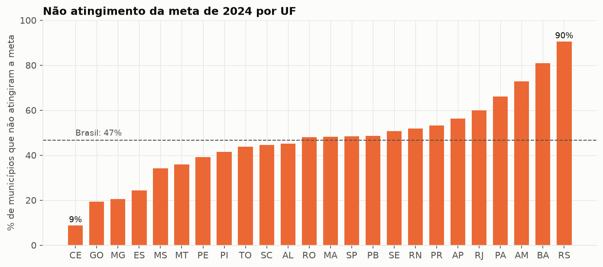

**Hipóteses analíticas e o que os dados disseram**

| # | Hipótese | Resultado | Evidência |
|---|---|---|---|
| H1 | Município mais rico ou maior alfabetiza mais | **Refutada** | Correlação PIB × risco: −0,02 entre UFs, 0,01 dentro delas (7.6) |
| H2 | Participação baixa só deixa o indicador mais ruidoso | **Refutada** | Volatilidade igual em todas as faixas; o que muda é a direção: +0,3 p.p. com participação baixa, +4,2 com alta (8.2) |
| H3 | Quem teve um ano muito bom tende a cair | **Confirmada** | Correlação de −0,45 entre a taxa e a variação seguinte (7.4) |
| H4 | O estado pesa mais que as características do município | **Confirmada** | UF sozinha tem AUC 0,73; o modelo inteiro, 0,79 (8.1) |
| H5 | A queda do RS em 2024 foi passageira | **Refutada em 2025** | 73,6% dos municípios do RS não bateram a meta de 2025 (6.6) |
| H6 | A escola explica a maior parte da diferença entre as crianças | **Refutada** | 77% da variação está entre alunos da mesma escola (8.5) |
| H7 | Metas não recalculadas depois de 2024 viram alvos difíceis | **Confirmada em 2025** | Com esforço acima do visto no treino, 48% falharam; nos demais, 17% (6.6) |

### 4.2 Pipeline e prevenção de vazamento

```python
Pipeline([
    ("prep", ColumnTransformer([
        ("num", Pipeline([("imputar",   SimpleImputer(strategy="median")),
                          ("limitar",   LimitarFaixa()),          # não extrapola
                          ("escalonar", StandardScaler())]), NUMERICAS),
        ("cat", Pipeline([("imputar",   SimpleImputer(strategy="most_frequent")),
                          ("codificar", OneHotEncoder(handle_unknown="ignore"))]), CATEGORICAS),
    ])),
    ("modelo", LogisticRegression(C=1)),
])
```

Quatro barreiras contra vazamento:

1. **Separação temporal.** Toda feature é do ano anterior ao alvo. O modelo simula o gestor no início do ano: conhece o resultado passado e a meta, não o futuro.
2. **Resultado do ano-alvo fora.** `_taxa_alvo` é removida antes do treino.
3. **Transformações dentro do Pipeline.** Mediana, média, desvio e categorias são aprendidas em cada fold, só com o treino daquele fold.
4. **Teste intocado.** Busca de hiperparâmetros e escolha do limiar acontecem só no treino. O teste é usado uma vez.

`LimitarFaixa` corta cada variável no mínimo e máximo do treino. No treino não muda nada; em 2025 impede que a regressão logística extrapole em linha reta (ver 9.3).

**Checklist do enunciado:**

| Requisito | Como foi feito |
|---|---|
| Engenharia de atributos | `esforco_exigido` (meta − taxa), log da população e do PIB por habitante, porte em faixas de política pública, `LimitarFaixa` |
| Imputação de faltantes numéricos | `SimpleImputer(strategy="median")` |
| Transformação de numéricas | log (população, PIB), `LimitarFaixa`, `StandardScaler` |
| Transformação de categóricas (feature encoding) | `OneHotEncoder` em UF, região e porte |
| Tratamento de data leakage | As quatro barreiras acima |
| Pré-processamento integrado ao modelo | Um único `Pipeline` do scikit-learn, salvo em `models/modelo.joblib` |
| Treino e validação | Seções 4.3 e 5 |
| Replicabilidade e generalização | Semente fixa, versões fixas, gap CV × teste (6.3), estabilidade em 8 sementes (7.1) |

### 4.3 Divisão em treino, validação e teste

- **Treino** 75% (3.924) / **teste** 25% (1.308), estratificado pelo alvo
- **Validação:** `StratifiedKFold(5)` dentro do treino, usada na busca de hiperparâmetros e na escolha do limiar
- Semente fixa (42) em todo o pipeline

### 4.4 Modelo por aluno

Mesmo `Pipeline` (imputação, `LimitarFaixa`, padronização, one-hot), com duas diferenças:

- **Duas linhas por escola:** alfabetizados e não alfabetizados, cada uma com o peso somado dos seus alunos. Equivale a uma linha por aluno (seção 3.5).
- **Separação por município:** todas as escolas de um município ficam do mesmo lado. Sem isso, o modelo veria escolas vizinhas no treino e a AUC sairia otimista.

O protocolo é o mesmo do nível 1:

1. **Teste:** 25% dos municípios (1.308) ficam fora de tudo (`GroupShuffleSplit`).
2. **Busca em grade** nos outros 3.924, com `GroupKFold(5)` por município e AUC **ponderada pelo peso dos alunos**. Os scorers padrão do scikit-learn ignorariam o peso, e aqui cada linha representa um grupo de alunos.
3. **Escolha** pela AUC de validação, com a mesma regra de interpretabilidade.
4. **Avaliação única** no teste.

A participação da escola na prova fica fora: ela só é conhecida no dia da avaliação, então não serve para antecipar.

## 5. Escolha do algoritmo

### 5.1 Comparação (AUC na validação cruzada, após `GridSearchCV`)

| Modelo | AUC | Desvio | Pior combinação | Melhor configuração |
|---|---|---|---|---|
| Baseline (`DummyClassifier`) | 0,500 | — | — | prevê a proporção |
| **Regressão logística** | **0,779** | 0,028 | 0,748 | `C=1` |
| Random Forest | 0,778 | 0,020 | 0,770 | `max_depth=12`, `min_samples_leaf=5` |
| Gradient Boosting | 0,776 | 0,020 | 0,747 | `lr=0,03`, `max_leaf_nodes=15`, `l2=0` |

23 combinações × 5 folds. Todo hiperparâmetro da grade é um freio contra overfitting (regularização, profundidade, folha mínima, taxa de aprendizado).

### 5.2 Por que a regressão logística

**Regra definida antes de rodar:** se a logística ficar a até 0,005 de AUC do melhor modelo, ela vence. Ficou empatada (0,001 acima).

O motivo é prestação de contas. Um alerta que direciona recurso público para crianças precisa responder "por que este município?". Na logística, cada coeficiente é uma frase legível; num ensemble de 300 árvores, não.

Os três modelos empatarem também diz algo: não há interação complexa para as árvores capturarem, e com ruído alto, flexibilidade extra vira ajuste ao acaso.

### 5.3 Modelo por aluno

| Modelo | AUC (validação) | Melhor configuração |
|---|---|---|
| Logística, só variáveis do município | 0,645 | `C=0,01` |
| **Logística, município + escola** | **0,652** | `C=0,01` |
| Boosting, município + escola | 0,652 | `learning_rate=0,05`, `max_leaf_nodes=31` |

12 combinações × 5 partições. Mesma regra do nível 1: logística e boosting empatam (diferença de 0,0003), então a logística vence por ser legível. A regularização quase não muda a AUC da logística (0,6516 a 0,6517 entre `C=0,01` e `C=10`): com 11 variáveis e 60 mil linhas, não há espaço para sobreajuste.

## 6. Métricas de avaliação

### 6.1 Teste (1.308 municípios, classe positiva = não atingiu)

| Métrica | Limiar 0,5 | **Limiar 0,38 (escolhido)** |
|---|---|---|
| AUC | 0,799 | 0,799 |
| **Recall** (falharam e foram detectados) | 65,6% | **81,0%** |
| Precisão (alertas que estavam certos) | 71,5% | 64,0% |
| F1 | 0,684 | 0,715 |
| Acurácia | 71,7% | 69,9% |
| Municípios sinalizados | 43% | 59% |

Matriz de confusão no limiar escolhido: dos 611 que falharam, **495 detectados e 116 perdidos**; 278 alarmes falsos entre os 697 que atingiram.

### 6.2 Por que mudar o limiar

Os dois erros não custam o mesmo:

- **Alarme falso:** apoio técnico vai para quem bateria a meta de qualquer jeito. Desperdício moderado.
- **Município perdido:** uma turma inteira passa pelo 2º ano sem intervenção.

Com o limiar padrão, o modelo deixaria passar 1 em cada 3 municípios que falham. O limiar foi escolhido nas previsões fora da amostra do **treino** como o maior corte que detecta 80% de quem falha. No teste, que não participou da escolha, ele detectou 81%: o critério generalizou.

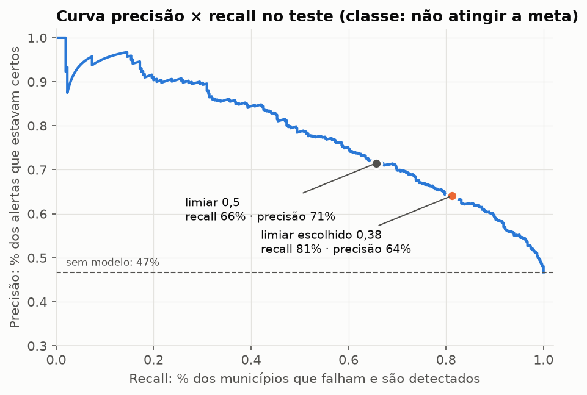

### 6.3 Generalização

| AUC CV | AUC teste | AUC fora da amostra na base inteira |
|---|---|---|
| 0,779 ± 0,028 | 0,799 | 0,787 |

O teste ficou 0,02 **acima** da validação, dentro do desvio entre folds: a divisão de teste foi um pouco mais fácil, não houve sobreajuste. A estimativa mais estável é a AUC fora da amostra nos 5.232 municípios: **0,787**.

### 6.4 As faixas de risco funcionam

Score de 2024 calculado fora da amostra (`cross_val_predict`) para todos os municípios, comparado com o que aconteceu:

| Faixa | Municípios | Falharam de fato |
|---|---|---|
| Baixo (< 0,25) | 1.234 | 15,7% |
| Moderado (0,25 a 0,38) | 866 | 32,1% |
| Alto (0,38 a 0,70) | 2.140 | 53,0% |
| Crítico (≥ 0,70) | 992 | **84,4%** |

### 6.5 Modelo por aluno e o teto do possível

40.088 escolas e 5.232 municípios, cobrindo 95% dos alunos avaliados em 2024. Teste com 1.308 municípios que o modelo nunca viu.

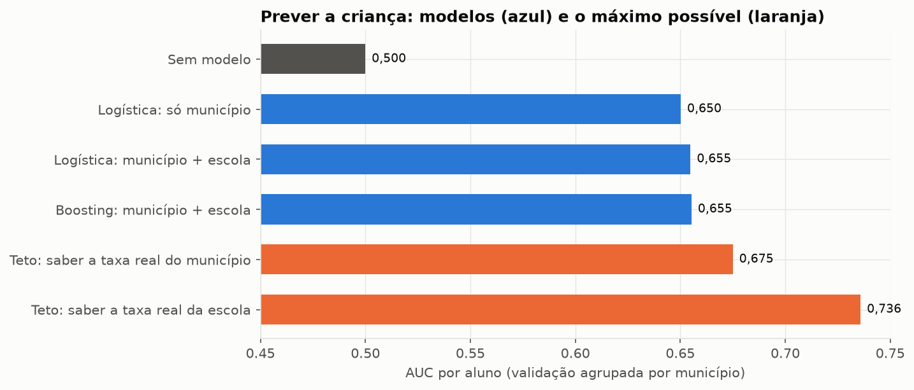

| | AUC por aluno |
|---|---|
| Validação (treino) | 0,652 ± 0,011 |
| **Teste** | **0,663** |

O teste ficou 0,011 acima da validação, dentro do desvio entre partições: não há sobreajuste.

Para saber se 0,663 é pouco ou muito, o modelo é comparado, **no mesmo teste**, com dois tetos que usam o resultado real de 2024, portanto impossíveis na prática:

| Referência | AUC no teste |
|---|---|
| Saber a taxa real do município em 2024 | 0,685 |
| **Saber a taxa real da escola em 2024** | **0,741** |

O segundo é o máximo que **qualquer** modelo com variáveis de escola alcançaria. O modelo percorre **68% do caminho** entre o acaso (0,5) e esse teto. O resto da distância até 1,0 está em informação da criança que os dados abertos não têm.

### 6.6 A previsão de 2025 contra o resultado real

O ranking de 2025 foi feito só com o que se sabia no início de 2025. O INEP publicou o resultado municipal de 2025 depois, e ele entrou na Gold. A base de previsão continua sem enxergá-lo: o ranking é o mesmo de antes, e a conferência fica em [`validacao_2025.py`](src/evaluation/validacao_2025.py).

| | Teste (2024) | **Real (2025)** |
|---|---|---|
| Municípios | 1.308 | 5.335 com resultado |
| Não atingiram a meta | 46,7% | **27,8%** (o modelo previa 43,7% em média) |
| AUC do modelo completo | 0,799 | **0,68** |
| AUC da probabilidade recomendada (RS sem o choque) | — | 0,60 |
| AUC de uma regra simples: ordenar só pelo esforço exigido | — | **0,745** |
| Alerta: recall / precisão | 81% / 64% | 64% / 34% |

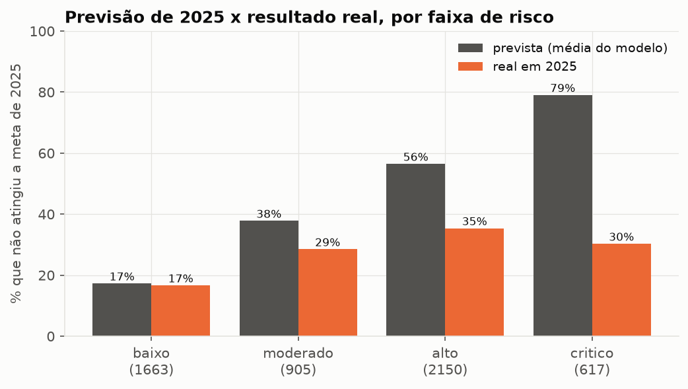

**O que aconteceu.** A taxa média dos municípios subiu de 62,8% para 72,3% em um ano, e só 27,8% não bateram a meta, contra 46,7% no ano do treino. O modelo aprendeu num ano ruim e superestimou o risco em todas as faixas, menos na mais baixa.

**Onde o modelo errou, e por quê:**
- **A faixa crítica não separou.** Só 30% dos críticos falharam, menos que na faixa alta (35%). Os críticos eram os de taxa mais baixa (54% em 2024), e foram os que mais subiram (+13,9 p.p.). A regressão à média que o modelo aprendeu (seção 7.4) veio mais forte do que em 2024.
- **O corte do esforço exigido custou caro.** Dentro da faixa vista no treino, modelo e regra simples empatam (AUC 0,666). Fora dela, nos 1.908 municípios com esforço acima de 7,2 p.p., o modelo cai para 0,569 e a regra fica em 0,615. O `LimitarFaixa` evitou extrapolar, mas tratou como iguais municípios que precisavam subir 8 e 20 p.p. Entre eles, 48% falharam; entre os demais, 17%.
- **A hipótese do RS estava errada.** O ranking avaliou o RS sem o choque das enchentes, apostando na recuperação. O RS não se recuperou: 73,6% dos municípios falharam. O modelo completo previa 77% em média, e o ajuste baixou para 33%. Por isso a probabilidade recomendada saiu pior que o modelo completo.

**O que acertou.** A faixa baixa: previsto 17%, real 17%. A ordem baixo < moderado < alto se manteve. O Brasil bateu a meta (66% contra 63,8%), e 19 de 26 UFs com meta também; ficaram abaixo AM, PA, RJ, RN, RS, SC e SP.

**Por que a regra simples funcionou agora e não antes.** Em 2024, o esforço exigido sozinho não separava nada (AUC 0,51, seção 4.1): as metas estavam perto da taxa e o ruído do indicador dominava. Em 2025, com as metas não recalculadas, o esforço passou a variar 2,5 vezes mais (desvio de 5,9 para 14,8 p.p., a deriva da seção 9.3) e virou a variável decisiva.

**Robustez.** Com o indicador oficial arredondado da planilha do INEP, que difere do microdado em alguns municípios, a conclusão não muda: 26,5% de falha, AUC 0,684 do modelo e 0,749 da regra simples. As duas fontes concordam em 98,7% dos casos.

## 7. Interpretação dos resultados

### 7.1 Importância por permutação (queda de AUC no teste)

| Variável | Importância | Posição nas 8 sementes |
|---|---|---|
| `taxa_atual` | 0,190 | 1–2 |
| `sigla_uf` | 0,185 | 1–2 |
| `media_portugues` | 0,058 | 3–4 |
| `esforco_exigido` | 0,056 | 3–4 |
| `regiao` | 0,037 | 5 |
| `participacao` | 0,013 | 6 |
| `log_populacao` | 0,008 | 7–9 |
| `log_pib_per_capita` | 0,000 | 7–8 |
| `porte_municipio` | 0,000 | 8–9 |

O ranking é estável: as posições variam no máximo uma casa entre sementes. Taxa e UF se revezam no topo.

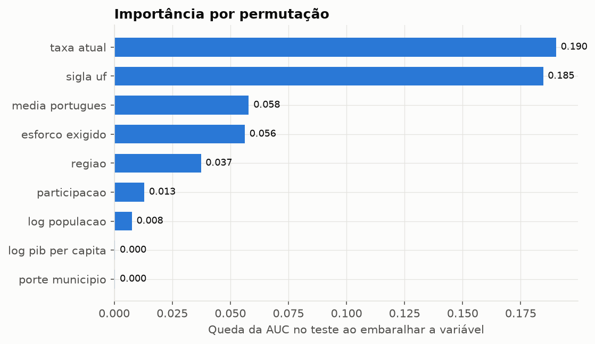

### 7.2 SHAP

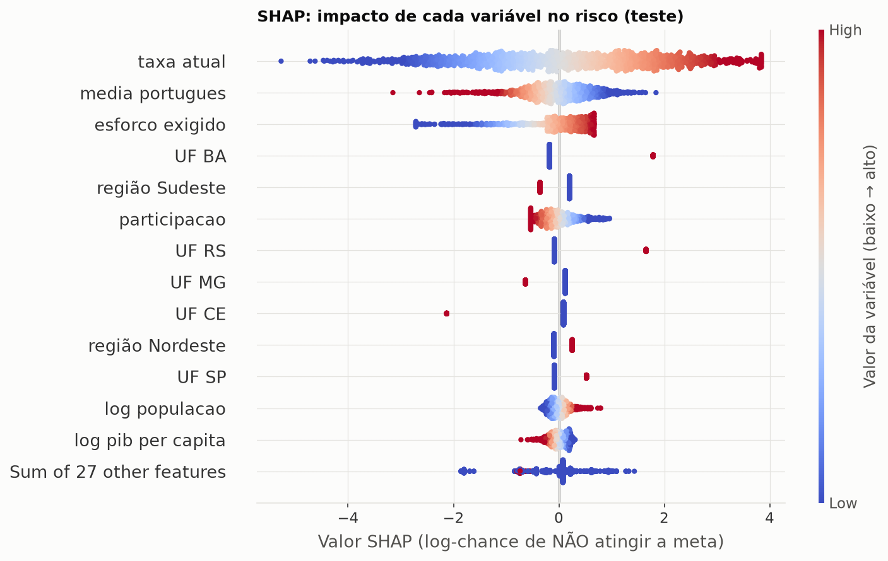

Cada ponto é um município do teste. À direita do zero, a variável empurra para o risco.

### 7.3 O que os coeficientes dizem

| Variável | Coeficiente | Leitura |
|---|---|---|
| `taxa_atual` | +1,89 | Com esforço e média iguais, **taxa alta aumenta o risco** (ver 7.4) |
| `esforco_exigido` | +0,73 | Quanto mais a meta pede, mais risco |
| `media_portugues` | −0,67 | Proficiência média alta protege |
| `participacao` | −0,32 | Mais alunos avaliados, menos risco |
| UF Ceará | −2,22 | Referência nacional em alfabetização |
| UF Bahia | +1,96 | Maior risco depois de controlar o resto |
| UF Rio Grande do Sul | +1,74 | Choque das enchentes de 2024 |

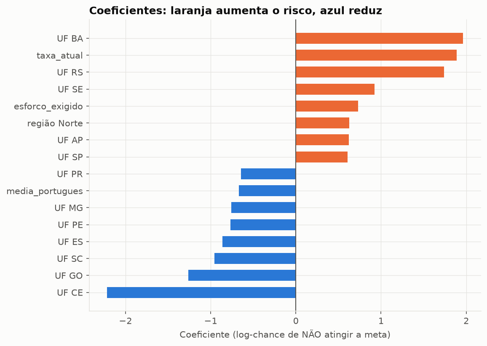

### 7.4 Regressão à média

Por que taxa alta aumenta o risco? Porque o indicador oscila muito, e quem teve um ano excelente tende a voltar.

| Quintil da taxa em 2023 | Variação média até 2024 |
|---|---|
| Mais baixo (até 43%) | **+12,1 p.p.** |
| Mais alto (acima de 78%) | **−9,1 p.p.** |

Correlação entre taxa de 2023 e variação: −0,45. A meta já compensa parte disso (exige mais de quem está embaixo), por isso a taxa sozinha não separa nada. O modelo acerta onde essa compensação erra.

### 7.5 Explicação de um município

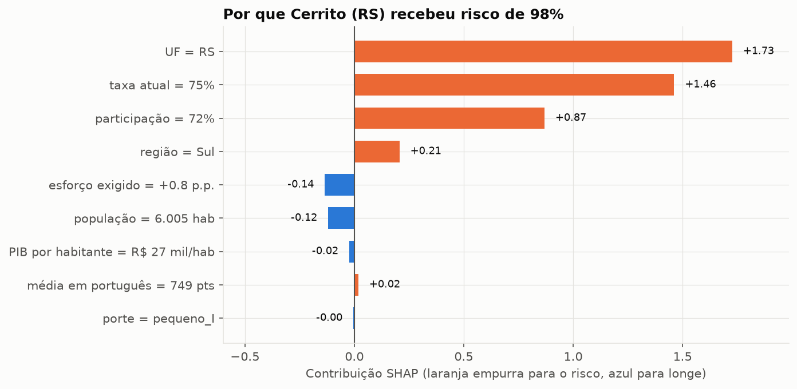

Cerrito (RS) tinha 75% em 2023, acima da média nacional, e recebeu 98% de risco. A maior parte vem da UF (o choque de 2024), seguida da taxa alta (regressão à média) e da participação baixa (72%). É o tipo de explicação que o gestor precisa para decidir se concorda com o alerta.

### 7.6 Riqueza e porte não importam

PIB por habitante e população têm importância praticamente nula. Entre UFs, a correlação entre PIB mediano e risco é −0,02; dentro de cada UF, 0,01. **Políticas que segmentam por "município pequeno e pobre" estariam olhando a variável errada.**

### 7.7 Modelo por aluno: o que pesa

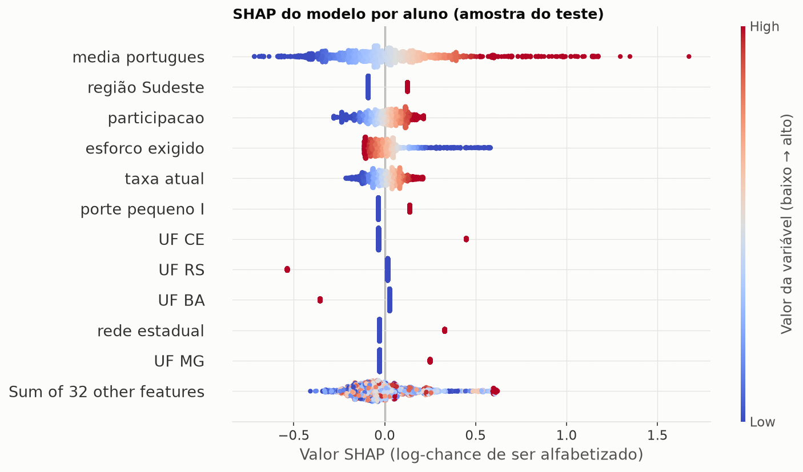

Cada ponto é uma escola do teste; à direita do zero, a variável aumenta a chance de a criança ser alfabetizada.

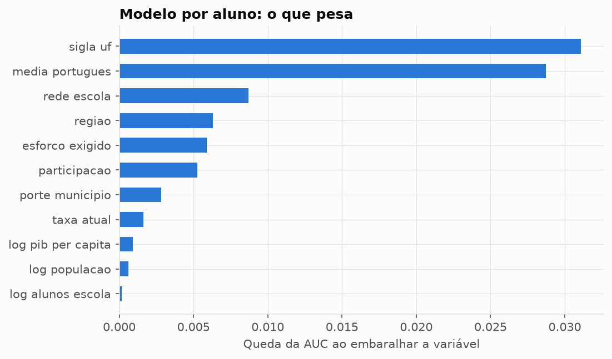

- **UF e média em português do município** dominam nas duas medidas (SHAP e permutação no teste).
- Ceará e Minas puxam para cima; Rio Grande do Sul (choque de 2024) e Bahia, para baixo.
- **Esforço exigido** alto reduz a chance; **participação** alta do município aumenta.
- **Rede estadual** aumenta a chance (61,7% de alfabetizados, contra 58,8% na municipal).
- O **tamanho da escola** não pesa: a taxa é praticamente a mesma em todas as faixas de porte.

É o mesmo padrão do nível municipal: o contexto estadual pesa mais que qualquer característica local, e a escola acrescenta pouco (+0,001 de AUC no teste sobre o modelo só com município).

## 8. Insights encontrados

### 8.0 Respostas às perguntas do desafio

| Pergunta | Resposta | Onde |
|---|---|---|
| Quais fatores mais impactam a alfabetização? | UF (efeito institucional, não econômico), regressão à média da taxa, esforço exigido e participação. Riqueza e porte quase não pesam. No nível da criança, 77% da diferença está dentro da mesma escola | 7.1, 7.3, 7.6, 8.5 |
| Quais municípios apresentam maior risco educacional? | 617 em risco crítico para 2025, concentrados na Bahia, Pará e Rio de Janeiro. Além deles, 542 municípios que bateram a meta têm escolas críticas escondidas pela média | 10.2, 8.6 |
| Quais regiões possuem padrões semelhantes? | 4 perfis (KMeans); o que mais separa é a participação: 59% de falha com participação baixa x 38% com alta | 8.3, `perfis.csv` |
| Como prever municípios que podem não atingir metas futuras? | Modelo treinado em 2023→2024 aplicado a 2024→2025, com limiar que detecta 81% das falhas no teste. Conferido com o resultado real de 2025: AUC 0,68, abaixo de uma regra simples (0,745), porque 2025 foi um ano de melhora geral | 6, 6.6, 10.2 |
| Quais variáveis possuem maior influência nos modelos? | Taxa atual e UF se revezam no 1º lugar nas 8 sementes; depois média de português e esforço. No modelo por aluno, UF e média de português do município; a escola acrescenta pouco | 7.1, 7.2, 7.7 |

### 8.1 O estado pesa mais que o município

Ceará: 9% dos municípios falharam. Rio Grande do Sul: 90%. A UF sozinha separa quase tão bem quanto o modelo inteiro (0,73 contra 0,79), e isso não é riqueza (7.6). O que a UF carrega é **institucional**: programa estadual de alfabetização, formação de professores, material estruturado, regime de colaboração com os municípios. A base não tem uma variável que descreva isso, então o modelo enxerga o efeito sem conseguir nomeá-lo.

### 8.2 Participação revela capacidade de gestão

| Participação em 2023 | Municípios | Não atingiram | Variação média | Volatilidade |
|---|---|---|---|---|
| < 85% | 1.070 | 60% | +0,3 p.p. | 16,1 |
| 85–90% | 1.309 | 52% | +2,5 p.p. | 15,8 |
| 90–95% | 1.730 | 42% | +3,6 p.p. | 16,7 |
| ≥ 95% | 1.123 | **35%** | **+4,2 p.p.** | 17,5 |

A hipótese inicial era que participação baixa só deixaria o indicador mais ruidoso. Não deixa: a volatilidade é a mesma. O que muda é a **direção**. Uma rede que leva 95% dos alunos à prova tem cadastro em dia, acompanha frequência e fala com as famílias, e é essa mesma capacidade que executa um plano de alfabetização.

### 8.3 Perfis municipais (KMeans, k = 4 pela silhueta)

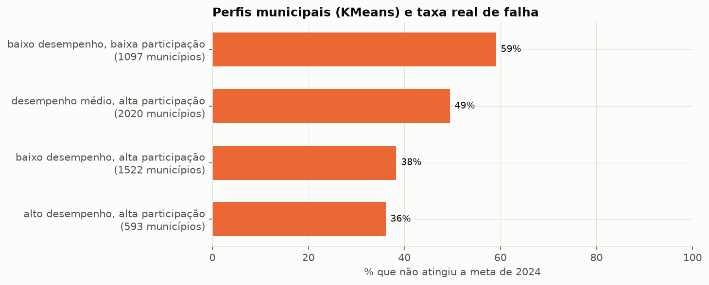

| Perfil | Municípios | Taxa 2023 | Participação | Não atingiram |
|---|---|---|---|---|
| Baixo desempenho, **baixa** participação | 1.097 | 50% | 81% | **59%** |
| Desempenho médio, alta participação | 2.020 | 71% | 92% | 49% |
| Baixo desempenho, **alta** participação | 1.522 | 42% | 92% | **38%** |
| Alto desempenho, alta participação | 593 | 92% | 94% | 36% |

O KMeans não vê o alvo, e mesmo assim os grupos têm taxas de falha bem diferentes. A comparação central: municípios com desempenho **pior** (42%) mas participação alta falham **menos** (38%) do que municípios com desempenho melhor (50%) e participação baixa (59%).

### 8.4 O choque do Rio Grande do Sul

O RS caiu, em média, 20 p.p. de 2023 para 2024, enquanto o resto do país subiu 4,8. As enchentes de abril e maio de 2024 fecharam escolas por semanas; o MEC atribuiu a elas a queda do indicador nacional (o RS foi de 63,4% para 44,7%) e estimou que, sem isso, o Brasil teria batido a meta de 60%.

Treinado com esse ano, o modelo aprende "RS = risco". Sem o RS, a AUC cai de 0,78 para 0,75 na validação: parte do sinal era o choque. **Por isso o ranking de 2025 avalia o RS com um modelo que não aprendeu o choque**: o alerta no estado cai de 96% para 38% dos municípios.

**O resultado de 2025 desmentiu essa hipótese:** 73,6% dos municípios do RS não bateram a meta. O modelo completo, que manteve o choque, estava mais perto (seção 6.6). O efeito das enchentes durou mais de um ano.

### 8.5 A diferença entre as crianças está dentro da escola

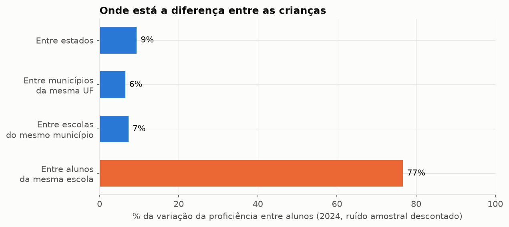

A variação de proficiência entre os 2,1 milhões de alunos de 2024 se divide em quatro partes que somam 100%:

| Onde está a diferença | % |
|---|---|
| Entre estados | 9,4 |
| Entre municípios da mesma UF | 6,5 |
| Entre escolas do mesmo município | 7,3 |
| **Entre alunos da mesma escola** | **76,7** |

O ruído de amostra das escolas pequenas foi descontado. Com o indicador alfabetizado (0/1) no lugar da proficiência, o quadro é o mesmo (85% dentro da escola).

Isso explica o teto da seção 6.5: saber onde a criança estuda ajuda, mas três quartos da diferença estão em coisas que só a escola enxerga, como frequência, avaliação diagnóstica e acompanhamento individual. **É ali que a política precisa chegar, e é ali que os dados abertos não chegam.**

### 8.6 Escolas críticas escondidas pela média

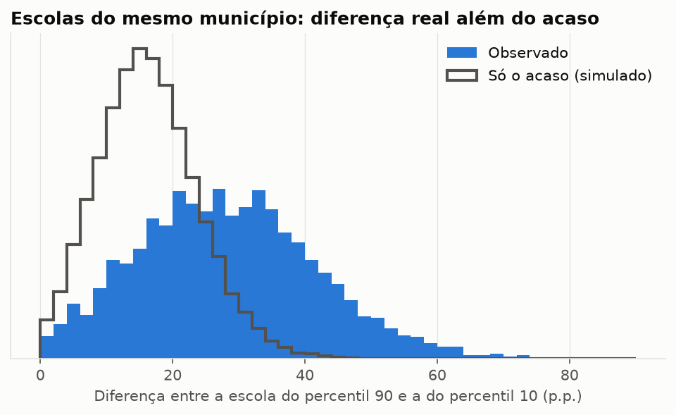

Dentro do mesmo município, a escola do percentil 90 e a do percentil 10 ficam a 28 p.p. de distância (mediana em 3.258 municípios). Escola pequena oscila muito por sorte, então a conta foi refeita em 20 simulações onde só o acaso separa as escolas: ele produziria 16 p.p. A diferença real estimada é de **~23 p.p.**

Nos 2.788 municípios que **bateram a meta de 2024**, há 1.530 escolas municipais com menos de 40% de alfabetizados. O acaso explicaria cerca de 756. **Cerca de 770 escolas críticas reais ficam escondidas pela média de municípios que bateram a meta**, em 542 municípios.

Como o código da escola é mascarado, o produto é a lista de municípios ([`municipios_com_escolas_criticas.csv`](reports/municipios_com_escolas_criticas.csv)), não a de escolas: a secretaria conhece as próprias escolas e consegue localizá-las.

## 9. Limitações do projeto

### 9.1 Ancoragem estadual

A UF é uma das duas variáveis mais importantes. O ranking concentra Bahia, Pará e Rio de Janeiro no topo, e um município bem gerido nesses estados herda risco por estar lá. **O score indica onde investigar, não onde punir.** Não deve condicionar repasse de recurso nem avaliar gestor, porque um município não escolhe em que estado está.

### 9.2 Teto de previsibilidade

A taxa varia com desvio de 16,6 p.p. de um ano para o outro; a meta pede, na mediana, 3,2 p.p. Entre os 18% que só precisavam não piorar, 45% falharam. Nenhum modelo com estas variáveis vai muito além de AUC 0,8. **Um resultado de 95% aqui seria sinal de vazamento.**

### 9.3 Mudança de distribuição em 2025

As metas de 2025 seguem a trajetória original e **não foram recalculadas** depois do resultado de 2024. Quem caiu em 2024 agora precisa subir muito: **36% dos municípios têm esforço exigido acima do maior valor visto no treino** (7,2 p.p.). O `LimitarFaixa` impede extrapolação, mas o modelo nunca viu esse cenário. O ranking marca esses casos na coluna `esforco_acima_do_treino`. O monitoramento de deriva ([`reports/drift.json`](reports/drift.json)) mede isso a cada execução: `esforco_exigido` é a única variável em alerta (PSI 1,26; acima de 0,25 é alerta); todas as outras estão estáveis. **Em 2025 o alerta se confirmou:** fora da faixa do treino, a AUC do modelo caiu para 0,569 (seção 6.6).

### 9.4 Uma única transição

Treino em 2023→2024, uma única vez. A validação com o resultado de 2025 (seção 6.6) mostrou o custo disso: o modelo aprendeu um ano ruim e errou o nível de risco de um ano bom. Agora há duas transições medidas (2023→2024 e 2024→2025); retreinar com as duas é a primeira evolução da seção 11.

### 9.5 Cobertura

DF, RR fora; AC só na previsão. O nível 2 cobre 95% dos alunos avaliados: ficam fora os municípios sem base municipal de 2023.

### 9.6 Socioeconômico limitado

Só PIB por habitante (2021). PIB mede produção, não bem-estar: um município com mineradora tem PIB alto e população pobre. Renda domiciliar, escolaridade materna e pobreza do Censo 2022 ainda não estão completas por município. IDHM foi descartado por ser de 2010.

### 9.7 Escola sem histórico

O INEP mascara o código da escola a cada edição: só 2% das escolas de 2024 têm o mesmo código em 2023. Não dá para usar o resultado da escola no ano anterior, que seria a variável mais forte do modelo por aluno, nem acompanhar uma escola ao longo do tempo. Pelo mesmo motivo, o ranking de escolas críticas não pode ser publicado escola a escola.

### 9.8 Nada da criança antes da prova

Os microdados não têm sexo, cor, idade, renda, frequência nem avaliação anterior. O modelo por aluno só conhece o endereço da criança, e por isso fica limitado (seção 6.5). Com 77% da variação dentro da escola, qualquer ganho real nessa previsão depende de dados que hoje só as redes têm.

## 10. Aplicação prática para políticas públicas

### 10.1 Produtos

| Arquivo | Para quê |
|---|---|
| [`ranking_2025.csv`](reports/ranking_2025.csv) | Fila de prioridade para 2025: score, faixa, perfil e observações |
| [`risco_uf_2025.csv`](reports/risco_uf_2025.csv) | Onde a ação precisa ser estadual |
| [`perfis.csv`](reports/perfis.csv) | Que tipo de apoio mandar para cada grupo |
| [`ranking_2024_oof.csv`](reports/ranking_2024_oof.csv) | Ranking de 2024 fora da amostra, comparado com o resultado real |
| [`municipios_com_escolas_criticas.csv`](reports/municipios_com_escolas_criticas.csv) | Municípios que bateram a meta de 2024 mas têm escolas abaixo de 40% |

### 10.2 Previsão 2025

| Faixa | Municípios |
|---|---|
| Baixo | 1.675 |
| Moderado | 908 |
| Alto | 2.152 |
| **Crítico** | **617** |

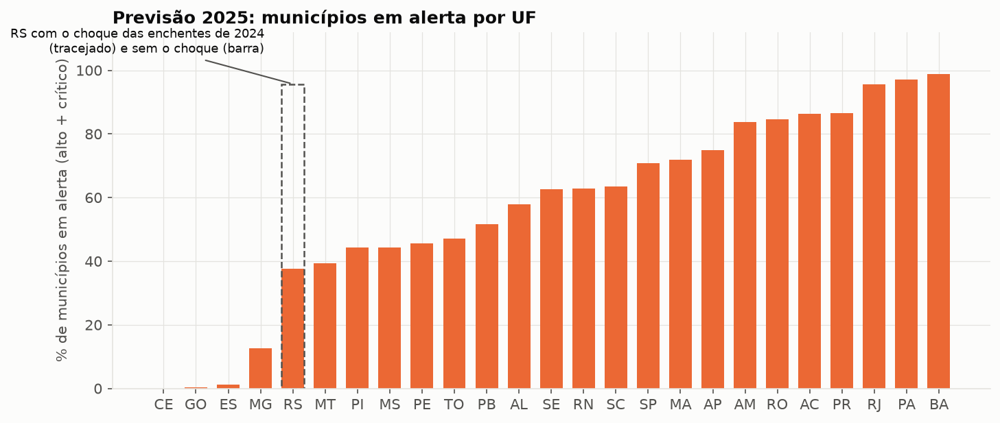

UFs com mais municípios em alerta: Bahia (99%), Pará (97%), Rio de Janeiro (96%), Paraná (86%). Com menos: Ceará (0%), Goiás (0,4%), Espírito Santo (1%), Minas Gerais (13%).

### 10.3 Como usar

1. **Começar pelos 617 críticos, mas ordenar também pelo esforço exigido.** Em 2024, 84% dos críticos falharam; em 2025, 30%. A validação mostrou que, num ano de melhora geral, o esforço exigido sozinho ordena melhor que o modelo.
2. **Escolher o tipo de apoio pelo perfil.**
   - Baixa participação → **apoio à gestão primeiro**: cadastro, frequência, comunicação com famílias. Mandar só material pedagógico tende a não surtir efeito.
   - Baixo desempenho com alta participação → **apoio pedagógico**: formação de professores, material estruturado. A gestão já funciona.
   - Alto desempenho → **documentar e espalhar** o que funciona.
3. **Agir no estado onde o alerta é quase total.** Na Bahia (99%) e no Pará (97%), negociar município a município é ineficiente: o caminho é a secretaria estadual.
4. **Acompanhar a participação durante o ano.** É conhecida antes do resultado. Rede abaixo de 85% pode ser sinalizada no mesmo ano letivo.
5. **Olhar dentro dos municípios que bateram a meta.** 542 deles têm escolas abaixo de 40% de alfabetizados. A média do município esconde essas escolas, e só a secretaria consegue localizá-las.
6. **Levar o acompanhamento para dentro da escola.** Três quartos da diferença entre as crianças estão entre colegas da mesma escola: avaliação diagnóstica e acompanhamento individual são onde a política tem mais espaço.
7. **Verificar localmente antes de concluir.** O SHAP de cada município mostra de onde veio o score.

### 10.4 Salvaguardas

1. O score **não** condiciona repasse de recurso.
2. O score **não** avalia gestor.
3. Todo município sinalizado exige verificação local.
4. O ranking é refeito a cada ciclo do INEP.

## 11. Possíveis evoluções futuras

**Dados**
- **Dados da criança com as redes:** frequência, avaliação diagnóstica de início de ano e histórico escolar, para o modelo por aluno ir além do teto da seção 6.5
- **Código de escola estável:** com acesso controlado ao código real (sala segura do INEP), usar o resultado da escola no ano anterior
- **Retreinar com as duas transições** (2023→2024 e 2024→2025) e validar no seguinte (2025→2026), para o modelo ver um ano ruim e um ano bom
- **Trocar o corte do esforço exigido** por uma variável de excesso (quanto passou do máximo do treino), e comparar sempre com a regra simples da seção 6.6
- Microdados por aluno de 2025 (já publicados pelo INEP) no modelo por aluno
- Variáveis de política estadual (programa de alfabetização, regime de colaboração), para transformar o "efeito Ceará" em algo acionável
- Censo 2022 por município: renda, escolaridade materna, desigualdade

**Modelagem**
- Modelo hierárquico com efeito aleatório por UF, separando formalmente estado e município
- Calibração das probabilidades (`CalibratedClassifierCV`) e intervalo de confiança por município
- Modelo de regressão para a taxa de 2025, complementar à classificação

**Engenharia**
- Base analítica como tabela da Gold na AWS, retreino automático a cada publicação do INEP
- Alerta automático (e-mail ou issue) quando o monitoramento de deriva sair de "estável"
- Consulta por município no dashboard Streamlit da Fase 2, com o SHAP de cada previsão

---

## Como reproduzir

```bash
python -m venv .venv
source .venv/bin/activate          # Windows: .venv\Scripts\activate
pip install -r requirements.txt

python -m src.run_pipeline             # tudo, ~3 min
python -m src.run_pipeline --rapido    # sem busca de hiperparâmetros
```

Rodar a partir da raiz do repositório. Cada etapa também roda sozinha (`python -m src.modeling.treinar`, por exemplo). Dados brutos e Gold estão versionados: não precisa de internet nem de AWS.

Cada execução grava o log completo em `logs/` e acrescenta uma linha em [`reports/execucoes.jsonl`](reports/execucoes.jsonl). Para conferir que os resultados batem com os publicados: `python -m src.checar_resultados`.

Para refazer a extração dos microdados por aluno (opcional; o agregado já está no repositório): baixe os zips de [2023](https://download.inep.gov.br/dados_abertos/microdados_avaliacao_da_alfabetizacao_2023.zip) e [2024](https://download.inep.gov.br/dados_abertos/microdados_avaliacao_da_alfabetizacao_2024.zip) para `data/raw/inep/microdados/` e rode `python -m src.preprocessing.microdados_inep`. O site do INEP às vezes recusa download fora do navegador: se os zips estiverem na pasta de downloads, o script os encontra (`~/Downloads`, ou a pasta indicada em `PASTA_DOWNLOADS`).

## Qualidade, rastreabilidade e monitoramento

A avaliação da Fase 2 apontou quatro problemas na pipeline de dados. Cada um tem uma resposta neste repositório:

| Problema na Fase 2 | O que este projeto faz | Onde |
|---|---|---|
| Gold gravada com um esquema e lida com outro; sequência do README quebrava | Esquema de cada tabela escrito uma vez e conferido ao gravar, ao ler e contra a documentação técnica. A cada pull request, o GitHub Actions roda o pipeline do zero numa máquina limpa e compara os resultados com a referência | [`contrato_gold.py`](src/preprocessing/contrato_gold.py), [`.github/workflows/pipeline.yml`](.github/workflows/pipeline.yml), [`checar_resultados.py`](src/checar_resultados.py) |
| Carga com sobrescrita, sem histórico | Cada execução acrescenta um registro: data, commit, versões, hash dos dados de entrada, tempo por etapa, métricas. Nada é sobrescrito | [`reports/execucoes.jsonl`](reports/execucoes.jsonl) |
| Deduplicação sem critério | Nenhum descarte silencioso: duplicata para o pipeline, e todo filtro registra quantas linhas saíram e por quê | [`reports/funil.json`](reports/funil.json) |
| Monitoramento e custo sem evidência | Logger padronizado gravando em arquivo; deriva entre treino e previsão medida a cada execução; tempo e custo no registro | `logs/`, [`reports/drift.json`](reports/drift.json) |

**O que para o pipeline e o que só avisa.** Erro de dado (coluna faltando, tipo errado, chave duplicada, microdado que não reproduz o indicador oficial) para a execução. Deriva não para: é um aviso para quem usa o ranking, registrado em `drift.json`.

**Custo (FinOps).** Tudo roda localmente em ~2 a 3 minutos, com ~10 MB de dados: custo de infraestrutura zero, registrado em cada execução (`recursos.custo_estimado_brl`). O GitHub Actions usa a cota gratuita de repositório público. A nuvem não entrou nesta fase porque o volume não justifica: o maior insumo, os microdados por aluno, vira um agregado de 79 mil linhas.

## Estrutura do repositório

Segue a estrutura mínima do enunciado:

```
📁 tech-challenge-fase3
│
├── 📁 data
│   ├── raw/inep/              CSVs da Base dos Dados, resultado de 2025 e planilhas do INEP, agregado dos microdados por escola
│   ├── raw/ibge/              localidades, população e PIB
│   ├── gold/                  star schema da Fase 2 (snapshot) + fato_meta_uf + fato_escola
│   └── processed/             bases de treino e previsão (gerado, fora do git)
├── 📁 notebooks
│   ├── 01_analise_exploratoria.ipynb
│   ├── 02_modelagem_e_resultados.ipynb
│   └── 03_escolas_e_modelo_aluno.ipynb
├── 📁 src
│   ├── preprocessing          gold.py · contrato_gold.py · base_analitica.py · funil.py · baixar_dados_ibge.py · microdados_inep.py · escolas.py
│   ├── modeling               treinar.py · transformadores.py · modelo_aluno.py
│   ├── evaluation             interpretar.py · aplicacao.py · drift.py · validacao_2025.py
│   ├── visualization          eda.py · estilo.py · desigualdade.py
│   ├── config.py              anos, caminhos, semente, limiar
│   ├── logger.py              logger padronizado (terminal + arquivo)
│   ├── checar_resultados.py   compara as métricas com a referência
│   └── run_pipeline.py        roda tudo na ordem e registra a execução
│
├── 📁 reports                 métricas (JSON), rankings (CSV), funil, deriva, registro de execuções, documentação técnica
├── 📁 images                  gráficos usados no README e no vídeo
├── requirements.txt
├── README.md
├── CONTRIBUTING.md           fluxo de trabalho do grupo
└── .gitignore
```

`models/` e `logs/` são criadas pelo pipeline e ficam fora do git. `.github/` guarda o teste automático e o modelo de pull request. `LICENSE` (MIT) é um extra: o enunciado define a estrutura **mínima**.

## Entregáveis

| Entregável do enunciado | Onde |
|---|---|
| Repositório Git completo | este repositório |
| Código-fonte organizado | `src/` em preprocessing, modeling, evaluation, visualization |
| Notebooks ou scripts | `notebooks/` (3, executados; o 02 inclui a validação real de 2025) e `src/` |
| README detalhado | este arquivo, com as 11 seções pedidas |
| Documentação técnica | [`reports/documentacao_tecnica.md`](reports/documentacao_tecnica.md) |
| Vídeo executivo | _link após a gravação_ |
| Pipeline reproduzível | `python -m src.run_pipeline`, conferido do zero pelo GitHub Actions a cada pull request |
| Análises e visualizações | `images/` (20 gráficos) e `reports/` |

## Organização do trabalho

O fluxo está em [`CONTRIBUTING.md`](CONTRIBUTING.md) e vale para qualquer pessoa do grupo:

1. **Uma branch por mudança**, com prefixo pelo tipo (`feat/`, `fix/`, `docs/`, `ci/`, `refactor/`).
2. **Pull request com modelo** ([`.github/pull_request_template.md`](.github/pull_request_template.md)): o que muda, por quê, efeito nos números e conferências feitas.
3. **Teste automático obrigatório:** o GitHub Actions roda o pipeline do zero; com o teste vermelho, o pull request não entra.
4. **Revisão antes do merge**, e merge com `--merge` para o histórico mostrar a origem de cada mudança.
5. **Decisão analítica nova vai para o registro** da documentação técnica, com motivo e evidência.

## Versionamento

Uma branch por etapa (`feat/base-dados`, `feat/eda`, `feat/modelagem`, `feat/interpretabilidade`, `feat/previsao-2025`, `docs/readme`, `feat/microdados-alunos`, `feat/desigualdade-escolas`, `feat/modelo-aluno`, `docs/readme-aluno`, `fix/modelo-aluno-teste-e-busca`, `refactor/download-ibge`, `fix/contrato-gold`, `fix/descartes-com-regra`, `feat/registro-execucao`, `feat/monitoramento-deriva`, `ci/pipeline-github-actions`, `docs/qualidade-e-monitoramento`, `feat/metas-estaduais`, `feat/resultado-2025`, `docs/validacao-2025`, `fix/portabilidade-e-colaboracao`, `docs/revisao-enunciado`), cada uma entrando na `main` por pull request. Commits no padrão `tipo: descrição`, com o porquê no corpo. As decisões analíticas estão registradas na [documentação técnica](reports/documentacao_tecnica.md#2-registro-de-decisões-analíticas).

## Autor

**Leonardo Azevedo** — pipeline da Fase 2 (AWS), reconstrução da Gold, modelagem municipal, previsão 2025, microdados por aluno, modelo por aluno e documentação.

Construído a partir do Tech Challenge da Fase 3 da pós em IA (FIAP Pós Tech, AI Scientist).

## Fontes

- INEP. Indicador Criança Alfabetizada e metas municipais, via [Base dos Dados](https://basedosdados.org/dataset/br-inep-avaliacao-alfabetizacao)
- INEP. [Microdados da Avaliação da Alfabetização](https://www.gov.br/inep/pt-br/acesso-a-informacao/dados-abertos/microdados) (2023 e 2024; de 2025, só o `TS_MUNICIPIO`)
- INEP. [Resultados do Indicador Criança Alfabetizada 2025](https://www.gov.br/inep/pt-br/areas-de-atuacao/avaliacao-e-exames-educacionais/avaliacao-da-alfabetizacao/resultados): planilhas de municípios, UFs e Brasil
- IBGE. [API de Localidades](https://servicodados.ibge.gov.br/api/docs/localidades) e [SIDRA](https://sidra.ibge.gov.br) (agregados 6579 e 5938)
- Queda do RS em 2024 atribuída às enchentes pelo MEC: [Lex Legal, 12/07/2025](https://lexlegal.com.br/?p=27209)

Licença MIT.
